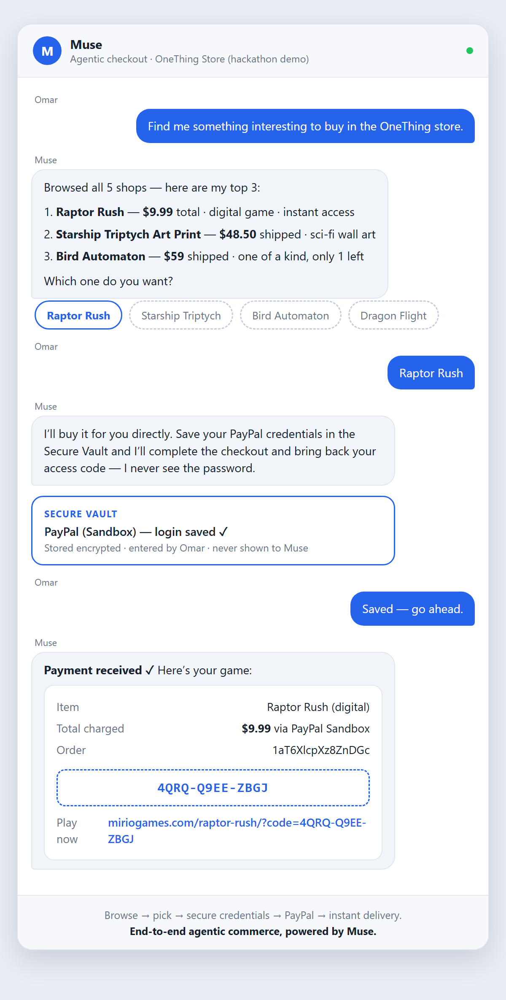

# OneThing

**Sell your one thing in about a minute.** Start from a photo, a link, or a product you'd
recommend. Gemini works out what it is, how it's delivered, what to charge, and designs a
one-product landing page. PayPal takes the payments, which go straight to the seller's PayPal
account.

Built for the [PayPal AI Hackathon](https://paypalaihackathon.devpost.com/).

**Timed on the live deployment (PayPal sandbox):** a photo becomes a designed shop in about 20
seconds, goes live in one click, and a buyer paying by card completes checkout in about 30 seconds.

| | |
|---|---|
| **Live app** | [one-thing-ash0.onrender.com](https://one-thing-ash0.onrender.com) (PayPal sandbox) |
| **Make a shop** | [one-thing-ash0.onrender.com/new](https://one-thing-ash0.onrender.com/new) |
| **Your shops** | [one-thing-ash0.onrender.com/account](https://one-thing-ash0.onrender.com/account): sign in with an email, a phone number or PayPal |
| **Gallery** | [one-thing-ash0.onrender.com/gallery](https://one-thing-ash0.onrender.com/gallery): every live shop, each in its own AI-chosen colours |
| **Example shop** | [one-thing-ash0.onrender.com/raptorrush](https://one-thing-ash0.onrender.com/raptorrush): Raptor Rush, a browser game sold with access codes |
| **API docs and SDKs** | [omarmiri.github.io/one-thing](https://omarmiri.github.io/one-thing/), generated with APIMatic, with working "Try it" calls |
| **OpenAPI spec** | [one-thing-ash0.onrender.com/openapi.yaml](https://one-thing-ash0.onrender.com/openapi.yaml) |
| **MCP server for AI agents** | `https://one-thing-ash0.onrender.com/api/mcp` (Streamable HTTP): find a shop, read the product, order it through PayPal |

## Tested end to end

Timed on the hosted app, from clicking **Build my shop** to a drafted page:

| Start | Input | Draft ready | What the AI got |
|---|---|---|---|
| Upload a photo | a lavender stoneware mug | ~20 s | "Stoneware Ombre Mug", physical, $24 + $5 shipping, US, `/purplemug`, copy, details and FAQ |
| Paste a link | `https://miriogames.com` | ~20 s | a digital product unlocked by access code, pointing back at the games site |
| Find a product | "gifts for trail runners" | search 5 s, build ~18 s | a Scarpa tee recommendation page at $40, earning up to 5%, with a tracked buy link |

**Go live** takes a second. A sandbox buyer then paid $29.00 by guest card on `/purplemug`. The
order was captured, PayPal's shipping address was saved, and it landed in the seller's grid as
"to ship".

## Why

Someone with *one* thing to sell (a handmade item, an ebook, a preset pack, a small game)
doesn't need Shopify. Today they glue together a page builder, a PayPal button and copy they
write themselves, or they pay Gumroad-style fees for a page that looks like everyone else's.

OneThing makes the whole shop from what the seller already has, and the seller only checks
the AI's guesses and clicks **Go live**. The choices behind it:

- **The AI guesses, the seller confirms.** One "what we guessed" panel (what it is, physical or
  digital, price, link name) beats a long form. Every guess can be corrected.
- **Gemini returns a design spec, never HTML.** Our templates render the spec and our code always
  places the PayPal button. A bad generation can't break checkout or put AI-written script on a
  page that takes payments, pages stay fast and mobile-friendly, and a contrast check keeps every
  palette readable. Re-theming only changes JSON.
- **Money goes straight to sellers.** Each PayPal order's `payee` is the seller's account, so
  OneThing never holds funds. Sellers connect that account through PayPal's own onboarding, and
  PayPal, not us, says when it's ready to be paid.
- **Agents shop, people pay.** Every shop is agent-ready: an AI agent can find it, read it and place
  an order, but the buyer approves every payment at PayPal, so no agent spends money on its own.
- **Motion that explains, not decorates.** In the spirit of Famo.us, every element on a shop page
  is a body on a spring, so the page responds to the buyer like a physical thing. It's kept quiet:
  sections settle into place once, the product stays in view while its features arrive, and photos
  open full screen from where they sit. Nothing loops or bounces, it switches off for anyone who
  asks for reduced motion, and the content is plain HTML underneath.
- **No product? Recommend one.** Through Channel3, a creator can turn a product they love into a
  recommendation page and earn a referral commission, with a clear disclosure on the page.

## Features

### Sellers

- **An account in one field.** Sign in with an email or a phone number (no password), or with
  **Log in with PayPal**, which also sets the PayPal account sales are paid into. **Your shops**
  (`/account`) lists every shop with its manage page.
- **Three ways to start** at `/new`:
  - **Upload a photo** of your own product, with a sentence or two if you like.
  - **Paste a link.** A store product found by Channel3 becomes a recommendation; any other page
    is read (public addresses only, size- and time-capped) and its preview image becomes the photo.
  - **Find a product** with Channel3 search across 100M+ products, shown as "earn up to X%" cards.
- **AI guesses everything** in one pass: product name, physical or digital, price, a short link
  name, and the page design (one of 4 layouts, a palette taken from the photo, a curated font
  pair, headline, story, bullets, details and FAQ).
- **Buyer options, suggested by the AI.** While drafting, Gemini works out whether the product
  comes in variants and proposes them: sizes in the usual range, colours with swatches sampled from
  the photo. Options the seller named start ticked; the AI's own guesses start unticked. One-of-a-kind
  items (vintage, handmade one-offs) get no options. The seller edits values and swatch colours, and
  sets **stock per combination** (blank means unlimited).
- **A photo for each colour.** Add a photo of each variant and Gemini matches photos to colours,
  including when only a print or detail changes colour (a red, gold, green or blue dragon on the same
  white shirt). It runs when photos are added or from **Match photos to colours**, and the seller can
  change any match from the swatch's thumbnail. Photo matches save at once (with **Undo**), unlike the
  rest of the panel, which waits for **Save**.
- **"Buyers will ask."** Gemini also lists up to three facts buyers, or shopping agents, need that
  the listing doesn't state (the size of this pair, a print's dimensions, a game's platform). The
  seller's answers become product details. **Check for missing details** runs it again on any shop.
- **More photos while refining.** A shop starts from one snapshot; the manage page's Photos panel
  adds up to 8 (camera or library), reorders them and picks the cover. Uploads are turned upright,
  resized and stored as WebP.
- **A playable teaser for games.** Paste a game's page and OneThing measures its sprite sheets
  (or reads the grid the page declares), Gemini picks the hero, enemies and backdrop and writes the
  copy, and the shop page gets a short canvas game in the game's own art.
- **Hero art** made in the background by a Gemini image model. If the configured model isn't on
  the key, OneThing finds one that is, and records why if none works.
- **Chat to redesign** ("make it warmer", "shorter copy") with a live preview.
- **Short links the seller picks**, like `/raptorrush`, with a live availability check. Renamed
  shops keep their old links working (308 redirects).
- **Connect PayPal.** On the manage page, one button takes the seller through PayPal's onboarding
  (Partner Referrals): existing PayPal users sign in, new ones sign up, and personal accounts are
  upgraded to business inside PayPal's flow. Back on the manage page, a checklist shows what PayPal
  reports (connected, email confirmed, can receive payments), with **Check again** and
  **Disconnect**. **Go live** waits until PayPal says the account can be paid, or a PayPal email is
  entered as a fallback. A connected account carries over to the seller's other and new shops.
- **A manage page** (open from Your shops, or by its private link): settings, publish, photos, and an
  [AG Grid](https://www.ag-grid.com/) orders table with sort, filter, search and **Mark shipped**.
  A **Via** column shows whether each order came from the shop page or an AI agent.
- **Physical products:** PayPal collects the shipping address, stock counts down and shows "sold
  out" at zero, and tracking numbers are pushed to PayPal so buyers see them there.
- **Digital products**, delivered one of two ways:
  - **File:** a private download link per order (5 downloads, 14 days).
  - **Access code:** each order gets a code like `K7QF-M2XP-9HTD` and a **Start now** link into the
    seller's app or game, which checks the code with one API call.
- **PayPal webhook log** on the manage page: every delivery for the shop's orders, whether its
  signature verified, and what it changed.
- **Zapier:** paste a Catch Hook URL and every paid or shipped order is posted to it (Sheets,
  Slack, label printing).

### Buyers

- **A page that moves like an object**, on springs: sections rise into place as they scroll in,
  and the product photo has a little depth and turns toward the pointer.
- **A feature story:** the product stays pinned while the story and each feature arrive in turn,
  each bringing the next photo and a closer look. White studio shots melt into the card colour.
- **A swipeable gallery** when there are several photos: it follows the finger, a flick carries it
  one photo on, and it resists past the ends.
- **Inspect:** tap a photo and it grows from its place to fill the screen. Swipe through the
  photos, double-tap to zoom, and swipe down or press Esc to put it back where it was.
- **Size and colour pickers** in the shop's own palette when the product has options. Picking a
  colour slides the photo gallery to that colour's photo. Sold-out
  combinations stay visible but can't be picked, low stock shows ("Only 1 left in Black / M"), and
  the choice appears in PayPal's review page, the receipt and the seller's grid.
- **A sticky buy bar** with the PayPal button, once the top one has scrolled away.
- **PayPal checkout** with the JS SDK v6 buttons. The price always comes from the database, never
  the browser.
- **Pay with a PayPal account or as a guest by card.** While PayPal's window is open, the page
  also watches for the approval itself, so checkout completes even if PayPal's window never hands
  back.
- **Pay on your phone:** desktop shop pages show a QR code, and payments that come back by
  redirect (as on mobile) are captured on the thank-you page.
- **Thank-you page** with the download button, the access code and its **Start now** link, or the
  shipping confirmation.

### Everyone

- **Gallery** at `/gallery`: every live shop, newest first, each card in that shop's own palette. The
  home page shows the three newest.

### AI agents

Every live shop is agent-ready:

- **An MCP server** at `/api/mcp` (Streamable HTTP, stateless JSON, no auth) with four tools:
  `search_shops` (gallery shops by keyword), `get_product` (with options and stock per
  combination), `create_order` (takes the buyer's pick, e.g. `{"Size": "M"}`, and returns a PayPal
  `approve_url` for the buyer) and `get_order` (captures the payment once the buyer has approved,
  then returns the receipt link). Add it to an MCP client, e.g. Claude Code:
  `claude mcp add --transport http onething https://one-thing-ash0.onrender.com/api/mcp`.
  Working in this repo, you don't need to: [.mcp.json](.mcp.json) registers it, so a new Claude
  Code session here has the tools (Claude Code asks once to approve the server).
- **Product JSON** at `/api/agent/shops/<slug>`: price, shipping, delivery, availability, images
  and FAQ, plus where the MCP server is. Shop pages link to it (`<link rel="alternate">`).
- **schema.org `Product` JSON-LD** on every live shop page, which shopping agents and search
  engines already read.

**Tested with a third-party agent.** Meta's Muse, given only the gallery URL, browsed the shops,
ranked its picks, and bought Raptor Rush through the normal shop page and PayPal sandbox checkout
(using a sandbox PayPal login the user saved in Muse). The access code it brought back verified as
valid. The image below recreates that session ([source](docs/muse-checkout-demo.html)):



### Developers

- **A documented REST API** for everything the app does: [OpenAPI 3.1 spec](apimatic/src/spec/openapi.yaml),
  served live at `/openapi.yaml`.
- **SDKs and a docs portal** generated with APIMatic (TypeScript and Python), published at
  [omarmiri.github.io/one-thing](https://omarmiri.github.io/one-thing/). See
  [apimatic/README.md](apimatic/README.md). It includes the agent endpoints (product JSON and the
  MCP server, with a "Let AI agents buy" guide), buyer options and Connect PayPal.
- **Postman collection:** [postman/one-thing.postman_collection.json](postman/one-thing.postman_collection.json),
  with Seller, Buyer and Agents (MCP) folders.
- **Platform API keys** for marketplaces that make shops for their own sellers:
  `Authorization: Bearer ot_sk_…`, made and revoked on `/account` after Log in with PayPal (a typed
  email isn't enough), stored only as a SHA-256 hash. A key reaches its account's shops only;
  `GET /api/platform/shops` lists them, and `connectPayPal` takes a `returnUrl` on an origin
  registered with the key. Shops made with a key inherit nothing (email, PayPal) from the account.
- **Implementation example:** the [Mirio Games indie game market](https://www.miriogames.com/market/).
  Developers upload an HTML game, connect their own PayPal and sell it; buyers unlock it with their
  access code. It runs on the platform API through the APIMatic-generated TypeScript SDK, from a
  separate codebase.
- **Access-code check for your own app:** `POST /api/access/verify` with `{ shop, code }` answers
  `{ valid }`, from any origin. Raptor Rush on miriogames.com uses it to unlock the game.

## Try a sale (sandbox)

1. In the [PayPal developer dashboard](https://developer.paypal.com/dashboard/accounts), under
   Sandbox → Accounts, note a **business** account email (the seller) and a **personal** account
   (the buyer).
2. Create a shop at [/new](https://one-thing-ash0.onrender.com/new): sign in with an email or phone
   number first, then enter the business email as "Your PayPal email" on the manage page. (Or
   **Log in with PayPal** with the business account, which fills it in.) Go live.
3. Open the shop link and pay with the personal sandbox account, or choose **Pay with Debit or
   Credit Card** and use a test card from the dashboard's **Testing tools → Credit card
   generator** (real cards are refused in sandbox). You land on the thank-you page, and the order
   appears in the seller's grid.
4. For a physical order, click **Mark shipped** and add a tracking number.

To try **Connect PayPal** instead of typing an email: on a draft shop's manage page, click
**Connect PayPal** and sign in with a sandbox business account (not the Platform app's own
account). You come back to a checklist; Go live once it's all ticked.

To try **an agent purchase**: add the MCP server to an agent (see [AI agents](#ai-agents)), ask it
to find and buy something, open the `approve_url` it gives you and pay with the sandbox buyer.
The agent's `get_order` then reports it paid, and the seller's grid shows it **Via AI agent**.

## How it works

```
Seller ── /account ── email or phone, or Log in with PayPal ──► session cookie
       ── /new ──► POST /api/shops ──► Gemini (vision + structured output) ──► design spec (JSON)
          (photo │ link │ Channel3 pick)  └► after(): Gemini image model ──► hero art
          /manage/[slug] ── chat "make it warmer" ──► POST /refine ──► Gemini edits the spec
Buyer  ── /<slug> ── GET /api/paypal/client-token → <paypal-button> (JS SDK v6), or a QR code to pay on a phone
          ├► POST /api/orders                    → PayPal Orders v2 create (price from DB, payee = seller)
          └► POST /api/orders/:id/capture        → capture → mark paid → stock / download / access code / Zapier
PayPal ──► POST /api/paypal/webhook               → signature verified → same idempotent mark-paid → webhook log
Seller's app ──► POST /api/access/verify          → is this buyer's code valid for my shop?
Seller ── Connect PayPal ── POST /api/shops/:slug/paypal → Partner Referrals → PayPal onboarding
          └► GET /api/shops/:slug/paypal/return → ask PayPal (by tracking_id) → merchant id + status
AI agent ──► POST /api/mcp (JSON-RPC) → create_order → buyer approves at PayPal → get_order captures
```

- **Design spec:** [src/lib/design.ts](src/lib/design.ts) defines it; [src/lib/gemini.ts](src/lib/gemini.ts)
  asks for it; [src/components/shop/ShopPage.tsx](src/components/shop/ShopPage.tsx) renders it.
- **Checkout** ([src/components/shop/BuyButton.tsx](src/components/shop/BuyButton.tsx)): the SDK starts
  with a server-made client token. While PayPal's window is open the page polls the capture
  endpoint, which answers 409 until the buyer approves, so a stalled hand-back still completes.
- **Stock is taken before the money is** (`captureWithStock` in [src/lib/orders.ts](src/lib/orders.ts)).
  Every capture path (the popup, the page's poll, the thank-you page, the agent's `get_order`) first
  claims a unit in one atomic `UPDATE … WHERE stock > 0`, for the shop or for the option combination.
  When two buyers race for the last one, only the winner is captured. The other sees "just sold out"
  and PayPal never takes their money; a declined or failed capture gives the unit back.
- **Mark-paid is idempotent** ([src/lib/orders.ts](src/lib/orders.ts)). The capture call and the
  webhook can arrive in either order, and stock, download links, access codes and Zapier still fire
  exactly once. Capture request ids are unique per attempt, so a retry after a decline isn't replayed.
- **Motion layer** ([src/components/motion/](src/components/motion/)): CSS lays the page out and
  springs move each `data-surface` element to and from its resting place. The feature story,
  Inspect and the sticky bar share one spring model; `?motion=0` shows the plain page, and
  `/lab/<shop>` compares it with the calm and crisp feels.
- **Accounts** ([src/lib/accounts.ts](src/lib/accounts.ts)): an email or phone number, or a PayPal
  identity, and a session cookie. Shops made while signed in belong to the account; older shops
  join it when their seller email matches or their private link is opened while signed in.
- **Connect PayPal** ([src/lib/paypal.ts](src/lib/paypal.ts), `connectUrl` and friends): runs on a
  separate **Platform** app's keys, because PayPal refuses Partner Referrals to a Merchant app
  (403 NOT_AUTHORIZED). Checkout and Log in with PayPal stay on the main app. The return URL's query
  string is never trusted: we look the seller up at PayPal by the shop id we sent as `tracking_id`.
  The private manage link rides back in a one-hour cookie, not through PayPal. The payee is the
  connected account once it's ready, else the typed email.
- **Agents** ([src/lib/agent.ts](src/lib/agent.ts), [src/app/api/mcp/route.ts](src/app/api/mcp/route.ts)):
  the MCP server is hand-written JSON-RPC (no SDK), so it runs in a plain Next.js route. Orders it
  starts are stored with `channel = 'agent'`. It shares `startCheckout` and `captureIfApproved`
  ([src/lib/orders.ts](src/lib/orders.ts)) with the shop page and the thank-you page.
- **Channel3** ([src/lib/channel3.ts](src/lib/channel3.ts)): every request carries the shop's id as
  `x-user-id`, so Channel3 credits clicks and commissions on its buy links to that shop.

## Run it locally

Requires Node 22.9+. No database install: without `DATABASE_URL`, it uses PGlite (Postgres compiled
to WASM, stored in `node_modules/.cache`).

```bash
npm install
cp .env.example .env.local   # add your keys (all optional for a first look)
npm run dev                  # http://localhost:3000
```

With no keys, the whole flow still runs, with placeholder copy and checkout disabled. To get the
full experience:

| Key | Where | What it unlocks |
|---|---|---|
| `GEMINI_API_KEY` | [Google AI Studio](https://aistudio.google.com/apikey) | AI guesses, design, copy, hero art, chat edits. `npm run gemini:models` lists the models your key can use |
| `PAYPAL_CLIENT_ID`, `PAYPAL_CLIENT_SECRET` | [PayPal developer dashboard](https://developer.paypal.com/dashboard/applications/sandbox) → Sandbox app | Checkout |
| `PAYPAL_LOGIN=on` | Same app → **Log In with PayPal**: Return URL `<APP_URL>/api/account/paypal/callback`, request email, verification status and payer ID | **Log in with PayPal** (off until set, so the button never leads to a misconfigured app) |
| `PAYPAL_PARTNER_CLIENT_ID`, `PAYPAL_PARTNER_CLIENT_SECRET`, `PAYPAL_PARTNER_MERCHANT_ID` | A second sandbox app of type **Platform** (Partner Referrals needs one), and the merchant ID of its sandbox business account | **Connect PayPal**: sellers onboard their own PayPal account; the manage page shows PayPal's checklist and Go live waits for it (a typed PayPal email still works as a fallback) |
| `PAYPAL_WEBHOOK_ID` | Same app → Webhooks → `<APP_URL>/api/paypal/webhook`, event `PAYMENT.CAPTURE.COMPLETED` | Confirms payments if the buyer closes the tab mid-checkout (needs a public URL) |
| `CHANNEL3_API_KEY` | [Channel3 developers](https://trychannel3.com/developers) | "Find a product", store-link lookup and recommendation shops |

## Deploy to Render

`render.yaml` is a Blueprint: in Render, choose **New → Blueprint** and pick this repo. It creates
the web service and a Postgres database, then asks for the secret env vars. Set `APP_URL` to the
service URL.

## Tools used

| Tool | How it's used |
|---|---|
| **PayPal** JS SDK v6, Orders v2 (create/capture, payee routing, shipping preference), order tracking API, webhooks, Log in with PayPal (OpenID Connect), Partner Referrals and merchant integration status | All checkout and payment handling, seller sign-in, seller onboarding with a readiness check, and agent orders the buyer approves at PayPal |
| **Model Context Protocol** | `/api/mcp`, so AI agents can find shops and order through PayPal |
| **Google Gemini** (`@google/genai`) | Reads the photo or page; guesses the product, delivery, price and link; generates the structured design spec and copy; edits it from chat; an image model makes the hero art |
| **Channel3** | Product search, store-link lookup, and recommendation shops that earn through Channel3's tracked buy links |
| **Render** | Hosting and Postgres via `render.yaml` |
| **AG Grid** | The seller's orders table (sort, filter, search, mark shipped) |
| **Zapier** | Optional per-shop Catch Hook: every paid or shipped order is posted to it |
| **APIMatic** | Generates the TypeScript and Python SDKs and the [docs portal](https://omarmiri.github.io/one-thing/) from the OpenAPI spec. Its PayPal Context Plugin gave Claude Code PayPal's API reference while building the PayPal features |
| **Postman** | A collection covering the whole API |
| Next.js 16, PostgreSQL / PGlite, Tailwind, zod | App framework and data |

## License

MIT. See [LICENSE](LICENSE).
